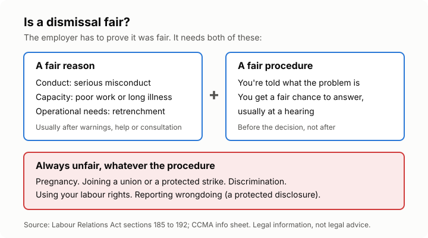

# Lesson 4: Dismissal, retrenchment and unfair labour practices
<!-- facts: Notice and severance; Dispute time limits -->

## By the end, the learner can

- Say the two things that make a dismissal fair: a fair reason and a fair procedure.
- Name dismissals that are automatically unfair.
- Explain retrenchment, notice and severance pay (from `facts.md`).
- Say what an unfair labour practice is, and the time limits for both (from `facts.md`).

## Key ideas

**Every employee has the right not to be unfairly dismissed** (LRA section 185). It counts as a
dismissal if you're fired with or without notice, if a fixed-term contract you reasonably
expected to be renewed isn't, if you're not allowed back after maternity leave, or if the
employer made work so intolerable that you resigned ("constructive dismissal").

**A fair dismissal needs both:**
1. **A fair reason:** your *conduct* (misconduct such as theft or violence), your *capacity*
   (poor work performance or long illness, usually after warnings, help or adjustments), or the
   employer's *operational requirements* (retrenchment).
2. **A fair procedure:** you're told what the problem is and get a fair chance to answer,
   usually at a hearing, before the decision.

Once you show you were dismissed, the employer has to prove it was fair (LRA section 192).

**Automatically unfair** reasons include: pregnancy, joining a union or a protected strike,
using your rights under labour law, discrimination (race, gender, religion, HIV status and
more), and reporting wrongdoing as a protected disclosure (LRA section 187).

**Retrenchment.** Before dismissing for operational reasons, the employer must consult you (or
your union) about ways to avoid it, how people are chosen, and severance (LRA section 189).
Severance pay has a legal minimum (`facts.md`).

**Notice.** Either side must give notice in writing, with a minimum length that grows with time
served (`facts.md`). The employer may pay you for the notice period instead.

**Unfair labour practice** is unfair treatment short of dismissal: around promotion, demotion,
probation, training or benefits; an unfair suspension or warning; refusing to re-employ you when
an agreement said they would; or punishing you for a protected disclosure (LRA section 186(2)).

**Time limits are short.** Dismissal and unfair labour practice disputes go to the CCMA within
the limits in `facts.md`. Lesson 8 shows how.

## Worked example

Sipho is retrenched after three years and five months. His minimum severance is three weeks'
pay (only completed years count), plus notice, plus any unpaid leave and wages owed.

## Exercise

Ask the learner which of these are automatically unfair: dismissed for being pregnant; dismissed
after a hearing for stealing stock; dismissed for joining a union. Then: Thandi was dismissed on
6 August. What is the last day to refer it to the CCMA?

## Sources

- [Labour Relations Act](https://www.gov.za/documents/labour-relations-act)
- [CCMA info sheet: Unfair dismissal disputes](https://www.ccma.org.za/wp-content/uploads/2025/08/Unfair-Dismissal-Disputes-info-sheet-2025-01.pdf)
- [Basic Conditions of Employment Act](https://www.gov.za/documents/basic-conditions-employment-act)
