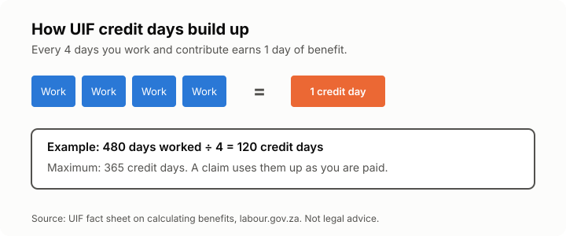

# Lesson 7: Claiming UIF
<!-- facts: UIF contributions; UIF benefits -->

## By the end, the learner can

- Name the benefits UIF pays, and who is covered.
- Explain credit days and roughly how much UIF pays (from `facts.md`).
- List the documents and steps to claim, and the deadline (from `facts.md`).
- Say what to do if a claim is turned down or the employer never paid UIF.

## Key ideas

**What UIF is.** The Unemployment Insurance Fund gives short-term relief if you lose your job or
can't work because of illness, maternity, parental leave or adoption, and pays dependants if a
contributor dies. It is insurance you paid for through your payslip (lesson 1), not a grant.

**Who is covered.** Employees who work at least 24 hours a month for an employer, including
domestic and farm workers. Your employer must register you and declare your pay every month.

**Credit days.** You build up benefit days while you work and contribute, up to a maximum
(`facts.md`). A claim uses them up. Lower earners get a bigger share of their pay back.

**Unemployment benefit.** You can claim if your job ended through dismissal, retrenchment or the
end of a contract. You must register as a work-seeker. Claim as soon as the job ends, and before
the deadline (`facts.md`). Claiming while you are working again ("work and draw") is a crime.

**Maternity, parental and illness benefits** pay a share of your pay while you're on leave
without full pay (`facts.md`). Your employer must help with the forms.

**Documents usually needed:** your ID or passport, banking details (form UI 2.8), the employer's
declaration of your employment (UI-19), and for unemployment, proof you registered as a
work-seeker. You then confirm your claim each month.

**How to claim:** online on uFiling (ufiling.labour.gov.za) or at a labour centre. Never pay
anyone to claim for you; the service is free.

**Problems.**
- *Turned down:* you can appeal (`facts.md`).
- *Employer didn't declare you or pay UIF:* report it at a labour centre. Check your payslips.
- *Employer won't give you the UI-19:* the labour centre can follow it up.

## Worked example

Zanele worked and contributed for two years, about 480 working days. That earns her 480 ÷ 4 =
120 credit days. She was retrenched on 31 May, so she registers as a work-seeker and claims on
uFiling in June, well within the deadline.

## Exercise

Ask the learner: Pieter worked 200 days before his contract ended. How many credit days has
he built up? What three documents should he gather first? What is his deadline to claim?

## Sources

- [UIF basic guide](https://www.labour.gov.za/DocumentCenter/Publications/Unemployment%20Insurance%20Fund/Basic%20Guide%20to%20the%20Unemployment%20Insurance%20Fund%20(UIF).pdf)
- [Fact sheet on calculating UIF benefits](https://www.labour.gov.za/DocumentCenter/Publications/Unemployment%20Insurance%20Fund/Fact%20Sheet%20on%20the%20Calculation%20of%20normal%20UIF%20benefit.pdf)
- [uFiling](https://ufiling.labour.gov.za/)
