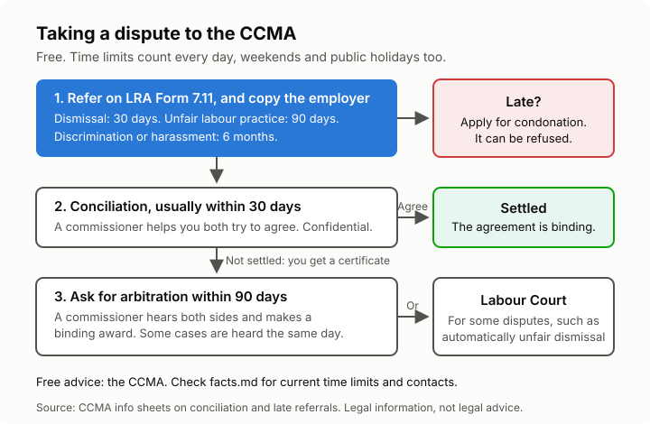

# Lesson 8: Taking a dispute to the CCMA, unions, and free help
<!-- facts: Dispute time limits; Earnings threshold; Where to get help -->

## By the end, the learner can

- Say which disputes go to the CCMA, and the time limits (from `facts.md`).
- Describe the steps from referral to conciliation to arbitration.
- Say what condonation is, and why acting early matters.
- Explain their right to join a union, and where to get free help.

## Key ideas

**The CCMA** (Commission for Conciliation, Mediation and Arbitration) settles workplace
disputes for free. If your sector has a **bargaining council**, that council may handle your
dispute instead; the CCMA will tell you. Typical disputes: unfair dismissal, unfair labour
practice, discrimination and harassment, and unpaid wages or leave pay if you earn up to the
earnings threshold (`facts.md`).

**Step by step:**
1. **Check the time limit now** (`facts.md`). Count from the day after the dismissal or act.
2. **Refer the dispute** on LRA Form 7.11, online at the CCMA's case referral site or at a CCMA
   office. Say what happened and what you want (for example, your job back or compensation).
3. **Send a copy to your employer** and keep proof that you did. The CCMA needs that proof.
4. **Late?** Add a condonation application: a sworn statement saying how late you are, why, and
   why your case is strong. The CCMA may refuse it, so don't rely on it.
5. **Conciliation.** A commissioner helps you and the employer try to agree, usually within 30
   days of your referral. It is confidential. A signed settlement is binding.
6. **Not settled?** You get a certificate. Then, within the time limit (`facts.md`), ask for
   arbitration (LRA Form 7.13), where a commissioner hears both sides and makes a binding award.
   Some disputes, such as automatically unfair dismissals, go to the Labour Court instead. Some
   are heard as "con-arb": arbitration straight after conciliation, the same day.

**At the hearings** bring your documents: contract, payslips, letters, notes, witnesses' names.
You don't need a lawyer; a union official or a co-worker can help you.

**Unions.** The Constitution and the LRA give every worker the right to form and join a union
and take part in its activities. An employer may not punish you for it; dismissing you for it is
automatically unfair. A union can advise you, represent you at work and at the CCMA, and
bargain for better pay. Strikes are protected only if the legal process is followed first.

**Free help:** the CCMA itself gives advice; the Department of Employment and Labour handles
unpaid wages, leave and UIF; and Legal Aid South Africa helps people who qualify. Contacts are in `facts.md`.

## Worked example

Kagiso is dismissed on 6 August without a hearing. On 10 August he refers the dispute online,
emails a copy to his employer and keeps the sent email. Conciliation fails in early September,
so he gets a certificate and asks for arbitration within 90 days.

## Exercise

Ask the learner to put these steps in order: arbitration award; send a copy to the employer;
conciliation; refer on Form 7.11; certificate of outcome. Then: what if Kagiso had waited until
20 September to refer?

## Sources

- [CCMA info sheet: Conciliation](https://www.ccma.org.za/wp-content/uploads/2022/01/Conciliation-Information-Sheet-2020-01.pdf)
- [CCMA info sheet: Late referrals and condonation](https://www.ccma.org.za/wp-content/uploads/2022/01/Late-referrals-Condonation-Applications-Info-Sheet-2018-01.pdf)
- [CCMA online case referral](https://cmsonline.ccma.org.za)
- [Labour Relations Act](https://www.gov.za/documents/labour-relations-act)
